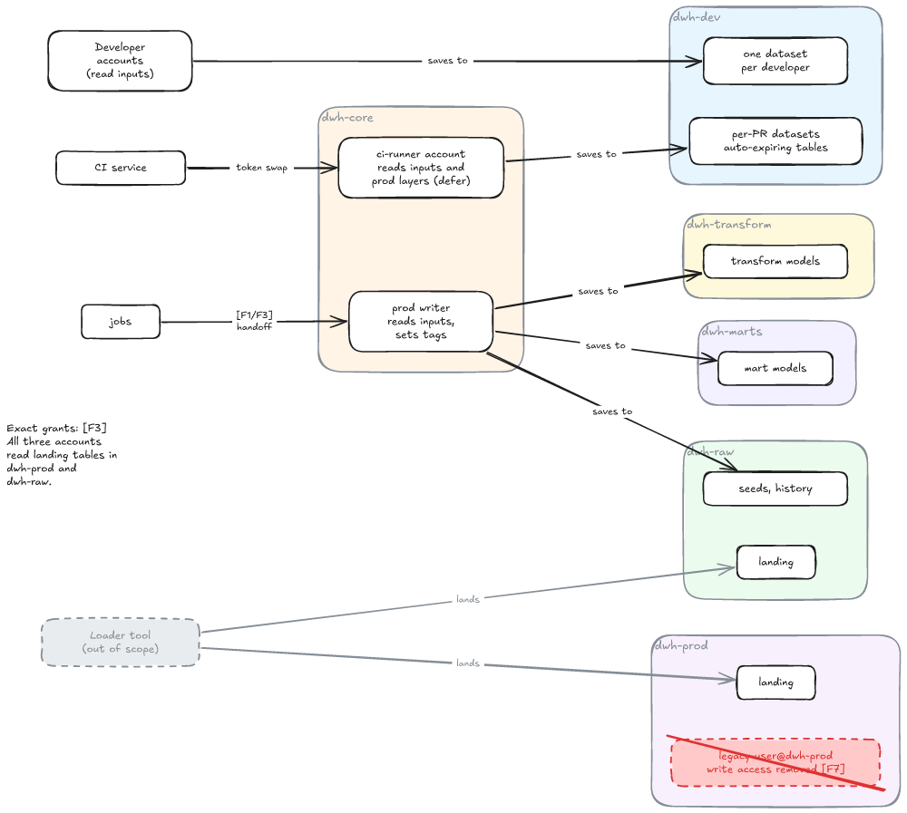
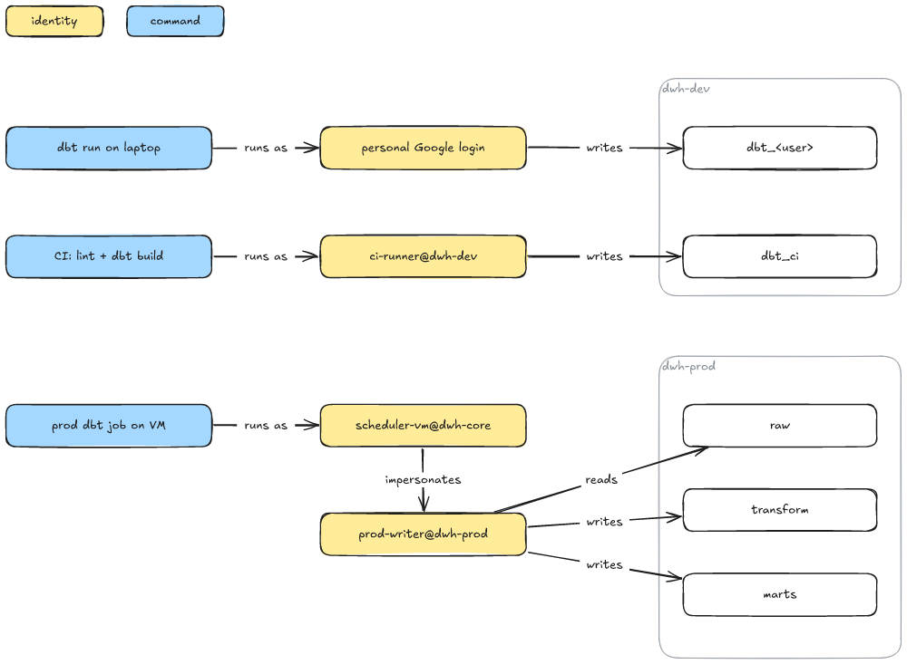
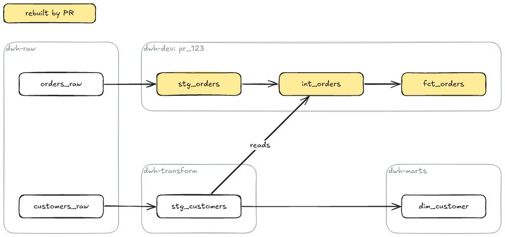
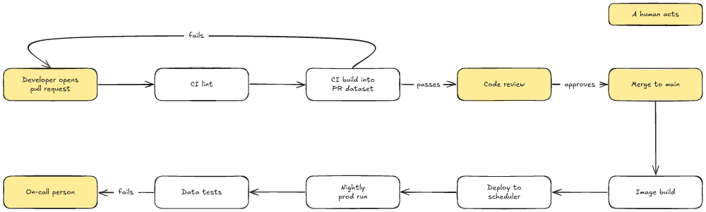

# Diagram style

The default look for a diagram you draw with `c2m excalidraw`. Follow it unless
the user gives their own styling instructions. Nothing here is linted: c2m never
warns about style, so the rules hold only if you apply them.

## Two passes; deliver only the second

### 1. Canonical pass (internal, never delivered)

While planning, draw the diagram all white. Do not render or deliver this pass.

- Every node: `backgroundColor` `#ffffff`, `fillStyle` `solid`, `strokeColor`
  `#1e1e1e`, and the default stroke width, roughness, font and font size.
  Reason: with nothing highlighted, a wrong layout or a missing arrow is easy to see.
- Grouping containers (a project, a lane) are the one exception: a thin grey
  stroke (`strokeColor` `#868e96`, `strokeWidth` `1`) and a title at the top
  left, given as the container's `label`. Reason: the group reads as a frame,
  not as one more node.
- No fills, no dashes, no key. Reason: those belong to the second pass.
- Get layout, text and arrows right here. Reason: the second pass must not
  move anything.

### 2. Highlight pass (the deliverable)

Same positions, same text, same arrows. Change only what marks the diagram's
point: fill colour, hatching (`fillStyle`), dashed strokes, shape. Reason: a
reader can compare the two passes and see that only emphasis changed.

## Colour

- **Colour means emphasis, and only that.** Painting every warehouse asset blue
  is emphasis too: it singles out which nodes belong to a category. Reason: a
  colour that means nothing still makes the reader look for a meaning.
- **There is no fixed palette.** Any colour can mean anything in a given
  diagram: grey can be "source" in one and "action" in another. Reason: the key
  says what a colour means, not a house rule.
- **At most 3 highlight colours, as few as possible.** Reason: past three, the
  reader stops holding the key in their head.
- **A single highlighted node is fine.** Reason: one thing to look at is the
  clearest point a diagram can make.

## Key

- **Add a key whenever a colour or dash pattern carries meaning.** It can be
  left out when there is exactly one highlight and its meaning is obvious.
  Reason: the reader should never have to guess what a style means.
- **Put the key at the top or on the right**, as labelled boxes that no arrow
  touches, each drawn in the style it explains. Reason: it is read first and
  stays out of the flow.

c2m's Mermaid preview recognises a key, and tags every node wearing a key style,
only when the boxes have this shape:

- two or more labelled boxes that no arrow touches;
- outside every group, and outside the rectangle around the connected diagram
  (the groups, every box inside a group, every box an arrow touches);
- each within 80 px of another key box;
- each in its own style (fill colour, fill pattern, line style), no two alike;
- each style worn by at least one element in the diagram.

A one-entry key draws fine, but the preview shows it as an ordinary box.

## Arrows

- **Labels are optional, at most 2 words.** Reason: the arrow shows the
  relation; the label only names it.
- **A mechanism word is fine** (`merge`, `reads`, `CDC DAGs`). Reason: it says
  how, which the arrow alone cannot.
- **No identifiers, no line breaks, no brackets.** Reason: they turn a label
  into a footnote the reader must decode.
- **Anything longer belongs in a node.** Reason: a node has room and a place in
  the layout; an arrow label does not.

## Examples

Each example is the JSON input and the PNG `c2m excalidraw --png` draws from it.

### Bad: [bad.json](diagram-style/bad.json)

Eight different tints with no key, so every colour asks for a meaning nobody
gives. Every arrow is labelled, and one label is an identifier pair in brackets
with a line break (`[F1/F3]` over `handoff`). The note on the left is a
footnote of grants that belongs in a node or in the text around the diagram.

### Good: [identity.json](diagram-style/identity.json)

Two highlight colours, one per category (identities, commands), explained by a
two-box key at the top. The datasets stay white inside grey-stroked containers
titled at the top left. Arrow labels are one or two words.

### Good: [pr-build.json](diagram-style/pr-build.json)

One highlight colour marks the models a pull request rebuilds; everything else
stays white. One arrow carries a label, the only one that needs it.

### Good: [release-path.json](diagram-style/release-path.json)

A process with no containers. The one highlight marks the steps where a human
acts, with a one-entry key at the top right. Only the branching arrows are
labelled (`passes`, `approves`, `fails`).
