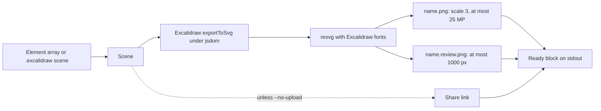

# v0.4.0: agents draw diagrams as PNG, no browser needed

## TL;DR

`c2m excalidraw --png` turns one or more diagrams into PNG files on the machine it runs on. Each diagram gets a full-size PNG for a Google Doc and a small one for a quick look, plus a ready-to-paste block: the image line, the edit link and the `images` map entry. No browser, and the drawing itself makes no network request.

## Why

An agent writing a Google Doc could already make an Excalidraw share link, but a link is not a picture. Getting a picture meant opening excalidraw.com in a browser and exporting by hand, which an agent on a headless box cannot do. Now the same command that builds the share link also draws the diagram, using Excalidraw's own renderer, so the PNG looks like what you see when you open the link.

## Highlights

| What | Detail |
|---|---|
| Two PNGs per diagram | `<name>.png` for the document, drawn at scale 3 and lowered until it has at most 25,000,000 pixels (Google Docs' limit); `<name>.review.png` at most 1000 px on the long side, for a reviewer to glance at |
| Ready block | per diagram: ``, `[Edit this diagram](<share link>)` and `"<name>": "@file64:/abs/path/<name>.png"` |
| Many at once | `c2m excalidraw --png a.json b.json ...`; each input is the element array `c2m excalidraw` already takes, or a whole scene such as a `.excalidraw` file |
| Where files go | the folder you name (`--png out/` or `--png=out/`), else `~/.cache/c2m/renders/` (`$XDG_CACHE_HOME/c2m/renders/` when set) |
| Self-cleaning cache | each run first deletes PNGs older than 24 h in the default folder; a folder you name is never cleaned, and nothing but `*.png` is touched |
| Offline drawing | Excalidraw's `exportToSvg` runs under jsdom from a bundle shipped in the package, then resvg turns the SVG into PNG with Excalidraw's own fonts |
| Check only | `--no-upload` still draws the PNGs; it skips the share link |



## Before / After

Before (`0.3.0`), `c2m excalidraw flow.json` gave a Mermaid preview and a share link, and the picture still had to be exported by hand.

After (`0.4.0`):

```
$ c2m excalidraw --png out/ flow.json

[Edit this diagram](https://excalidraw.com/#json=<id>,<key>)
"flow": "@file64:/abs/path/out/flow.png"
review: /abs/path/out/flow.review.png
```

Read the Mermaid preview first (rerun without `--png`, or `c2m diagrams show <file>` for a whole scene); open the review PNG only when the preview cannot answer the question.

## Upgrade notes

- **New runtime dependencies:** `@resvg/resvg-js` (SVG to PNG, a native binary per platform), `jsdom` (runs Excalidraw's renderer without a browser) and `wawoff2` (turns Excalidraw's woff2 fonts into fonts resvg can read). They load only when `--png` is used.
- **Bigger package.** The Excalidraw renderer and its fonts ship pre-built in `vendor/excalidraw/`, so the tarball grows to about 2.9 MB (8.5 MB unpacked). `@excalidraw/excalidraw` itself is not a runtime dependency.
- **CJK text renders blank.** The CJK font is 13 MB and is left out of the package, so Chinese, Japanese and Korean text is not drawn. Such a diagram still renders, and its block gets `warning: CJK text is not drawn: the CJK font is not shipped`.
- Nothing else changes: without `--png`, `c2m excalidraw` behaves exactly like `0.3.0`.

## Files changed

- `bin/excalidraw.js`: `--png`, the ready block, help text
- `src/excalidraw-png.js`: new; scene to PNG, scale stepping, cache clean-up, CJK check
- `scripts/build-excalidraw-bundle.mjs`: new; builds `vendor/excalidraw/` on install and pack
- `tests/diagrams/png.test.js`, `tests/fixtures-png/`: a fixed scene and its known-good render
- `docs/architecture/diagrams.md`: where the PNG path lives
