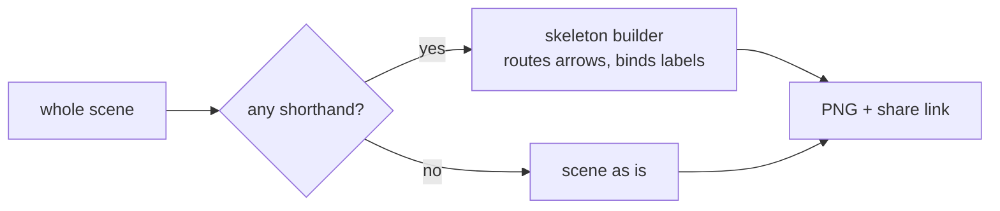

# v0.4.1: whole scenes accept the shorthand under --png

## TL;DR

`c2m excalidraw --png` no longer crashes on a whole scene (`{"type": "excalidraw", "elements": [...]}`) whose elements use the shorthand from `--help`: `label`, `"start"`/`"end"` bindings and arrows without `points`. Such a scene is now drawn and uploaded exactly like the same elements given as a bare array.

## Why

`--help` promises that each `--png` input is either the element array or a whole scene. In v0.4.0 a whole scene skipped the step that turns the shorthand into real Excalidraw elements, so a bound arrow reached the renderer with no points and the run died with `Cannot read properties of undefined (reading 'length')`. The same elements as a bare array worked, which made the failure look random. Without `--png`, `c2m excalidraw scene.excalidraw` already handled the shorthand.

## Highlights

| What | Detail |
|---|---|
| Shorthand in a scene | a scene with any `label`, `start`, `end`, or an arrow or line without `points` goes through the same builder as an element array: arrows are routed, labels become bound text, warnings are printed |
| Real scenes unchanged | a scene with none of the shorthand, such as one saved from excalidraw.com, is still drawn and uploaded as is, field for field |
| Scene settings kept | a shorthand scene keeps its own `appState` and `files` |



## Before / After

Before (`0.4.0`):

```text
$ c2m excalidraw --png out --no-upload request-flow.excalidraw
c2m excalidraw: request-flow: Cannot read properties of undefined (reading 'length')
```

After (`0.4.1`):

```text
$ c2m excalidraw --png out --no-upload request-flow.excalidraw

"request-flow": "@file64:/abs/out/request-flow.png"
review: /abs/out/request-flow.review.png
```

## Upgrade notes

Drop-in. Nothing that worked in v0.4.0 behaves differently.

## Files changed

- `bin/excalidraw.js`: a whole scene that uses the shorthand goes through the skeleton builder; help text says so
- `tests/diagrams/png.test.js`: a shorthand scene renders and uploads like the array form; a full Excalidraw scene uploads unchanged
- `README.md`: the `--png` input sentence mentions the shorthand in a scene
- `tests/clipboard-convert.test.js`: the deadline test steps fake time with real pauses, so it no longer fails on a slow CI runner
