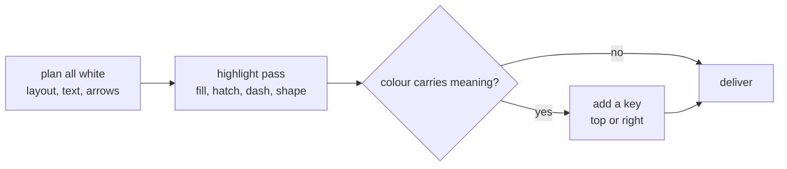

# v0.5.0: a house style for diagrams, group titles at the top left, stable wobble

## TL;DR

`c2m excalidraw --help` now carries a short house style for diagrams, with the full guide and good and bad examples in `docs/reference/diagram-style.md`. A group box's `label` is drawn as a title in its top-left corner instead of centred over the boxes inside it. And every element's hand-drawn wobble is derived from its id, so the same diagram draws the same way on every run.

## Why

Agent-drawn diagrams were noisy: a different tint on every node, and long annotations on every arrow (ids, brackets, line breaks). The house style writes down the opposite: plan the diagram all white, then colour only the few nodes that carry its point, with a key when a colour means something.

Two gaps in c2m stopped agents from following it. A group box's label landed in the middle of the box, on top of its own contents, so agents faked a title with a separate text element; the Mermaid preview then could not name the group. And the seed behind the hand-drawn look was random, so two renders of one diagram (a plain pass and a highlighted pass, say) never lined up.

## Highlights

| What | Detail |
|---|---|
| Style guide | `docs/reference/diagram-style.md`: two passes (plan all white, deliver a highlight pass), colour as emphasis only, at most 3 colours, a key at the top or right, arrow labels of at most 2 words. Described, never linted |
| Style in `--help` | a `STYLE` section summarises the guide and links to it |
| Examples | `docs/reference/diagram-style/`: one bad and three good diagrams, JSON plus PNG |
| Group titles | a shape that fully encloses another shape puts its `label` top-left, where Excalidraw itself would put it. `label.textAlign` and `label.verticalAlign` override |
| Stable seeds | `seed` and `versionNonce` are hashed from the element id, including bound labels. A `seed` in the input still wins |



## Before / After

Before (`0.4.1`), a group box with a label:

```text
+----------------------------------+
|  +---------+          +--------+ |
|  | Extract |-Pipeline>|  Load  | |
|  +---------+          +--------+ |
+----------------------------------+
```

After (`0.5.0`):

```text
+----------------------------------+
| Pipeline                         |
|  +---------+          +--------+ |
|  | Extract |--rows--->|  Load  | |
|  +---------+          +--------+ |
+----------------------------------+
```

## Upgrade notes

- A labelled group box now shows its title top-left. Leave about 40 px above the first row inside it. To keep the old centred label, set `"label": {"text": "...", "textAlign": "center", "verticalAlign": "middle"}`.
- A diagram that faked a group title with a separate text element still draws; move the text into the group's `label` to get the name into the Mermaid preview.
- Renders without an explicit `seed` now look the same on every run, but different from any earlier render.

## Files changed

- `src/diagrams/skeleton.js`: group box detection and top-left placement of its label; seeds derived from ids
- `tests/diagrams/skeleton.test.js`: group titles, alignment overrides, the preview's subgraph name, stable and explicit seeds
- `bin/excalidraw.js`: `STYLE` section and group-title notes in `--help`; the input example is all white
- `docs/reference/diagram-style.md` and `docs/reference/diagram-style/`: the guide and its examples
