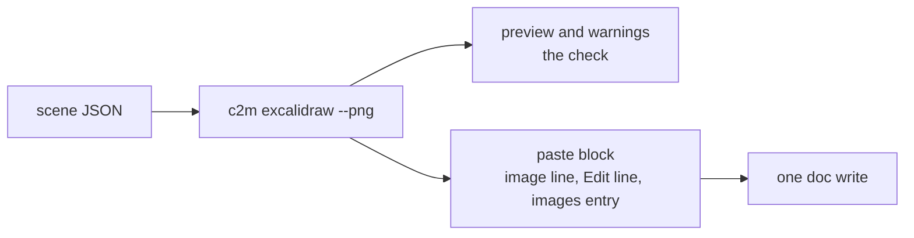
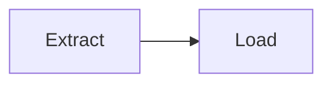

# v0.6.0: one command from scene to doc-ready paste block, a style op, two new layout warnings

## TL;DR

`c2m excalidraw --png` now prints everything an agent needs to put a diagram in a Google Doc in one block: the Mermaid preview, the warnings, the image line, the share link as an `Edit: <url>` text line and the images map entry. `--out <folder>/images/` draws straight into a working copy instead. No review PNG is written unless you ask for one with `--review`. `c2m diagrams edit` gains a `style` op and can write the edited diagram as a PNG with `--out <file>.png`. And the layout check now warns about crowded shapes and crossing arrows.

## Why

Putting a diagram in a doc took three steps: draw it, check it (often by opening a review PNG, which costs far more than reading the preview), then hand-assemble the lines to paste. The check and the paste block now come out of the same run, and the preview plus warnings are the check.

The share link used to sit behind the words "Edit this diagram". Once pasted, a reader saw the words but not the link, and an agent reading the doc as text later had to dig for it. Alt text cannot carry it either, since no Docs API request sets an image's alt text. So the link now sits as plain text under the image.

Highlighting one node of an existing diagram meant redrawing it from JSON. The `style` op does it in place, and `--out <file>.png` gives the restyled picture without a second command.

## Highlights

| What | Detail |
|---|---|
| Paste block | per diagram: Mermaid preview, warnings, ``, `Edit: <share link>`, `"<name>": "@file64:/abs/path/<name>.png"` |
| Working copy | `--out <folder>/images/` writes the PNG there and prints ``; no `@file64:` entry |
| Review PNG | only with `--review`; the preview and warnings are the check |
| Link line | `Edit: <url>` replaces `[Edit this diagram](<url>)` |
| `style` op | pick by `nodes` (Mermaid ids), `type` or both; set stroke, fill, width, dash, fill style, roughness, opacity on the shape or arrow, and text colour, font family and size on its label |
| `edit --out x.png` | draws the edited diagram with the same renderer and scale as `excalidraw --png`; stdout is still the new link |
| Layout warnings | shapes closer than 30 px edge to edge; two arrows that cross without sharing a shape |



## Before / After

Before (`0.5.0`), per diagram:

```text

[Edit this diagram](https://excalidraw.com/#json=abc,key)
"flow": "@file64:/home/me/.cache/c2m/renders/flow.png"
review: /home/me/.cache/c2m/renders/flow.review.png
```

After (`0.6.0`):

````text


Edit: https://excalidraw.com/#json=abc,key
"flow": "@file64:/home/me/.cache/c2m/renders/flow.png"
````

## Upgrade notes

- Anything that parsed the `[Edit this diagram](...)` line should look for a line starting with `Edit: ` instead.
- Anything that read the `review:` line gets it only with `--review`.
- `--png <dir>` and `--out <dir>` cannot be combined.
- Scenes that drew cleanly before may now warn about crowded shapes or crossing arrows.

## Files changed

- `bin/excalidraw.js`: the paste block, `--out <folder>/images/`, `--review`, the new warnings in `--help`
- `bin/diagrams.js`: `edit --out <file>.png` and the `style` op in `--help`
- `src/diagrams/edit.js`: the `style` op
- `src/diagrams/skeleton.js`: crowded and crossing warnings
- `tests/diagrams/` and `tests/fixtures-layout/`: one fixture scene per warning, plus a clean scene that expects none
