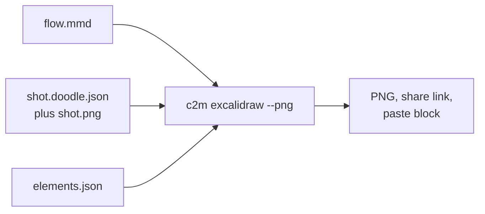

# v0.7.0: Mermaid in, and annotated screenshots

## TL;DR

`c2m excalidraw` now takes two new kinds of input and gives the same outputs as before (PNG, share link, paste block). A `.mmd` Mermaid file is drawn as Excalidraw shapes in the house style. A small JSON "doodle" spec turns a screenshot into a Head First style figure: handwritten notes in the margins and curved arrows to the parts they explain.

## Why

Diagrams for docs were often already written in Mermaid, and redrawing them as an element array cost a whole layout pass. Mermaid already knows how to lay a flowchart or a sequence diagram out, so now it does.

Screenshots in docs need pointing at: "this field", "this number comes from there". Doing that by hand in a drawing tool does not fit an agent pipeline. A doodle spec names the picture and, per note, the point or box it is about; the layout keeps every note off the picture and off the other notes.

## Highlights

| What | Detail |
|---|---|
| Mermaid input | any input ending `.mmd` or `.mermaid`; flowcharts and sequence diagrams become editable shapes; other types become one picture, with a warning |
| House style | white nodes, dark stroke, Excalifont; Mermaid's grey and yellow fills are dropped; labels wrapped mid-word by a narrow shape are put back on one line |
| Doodle input | `{"image": "shot.png", "notes": [{"text", "target": [x, y] or [x, y, w, h], "side"}]}`; optional `width`, `color` |
| Doodle layout | notes stack in the margin on their side (nearest edge by default), are pushed apart at the corners, wrap at ~28 characters; box targets get an outline |
| Pictures in PNGs | pictures now scale to their placed size (they used to come out at their own pixel size, cropped) |



## Before / After

Before (`0.6.0`): `c2m excalidraw flow.mmd` failed with "input is not valid JSON".

After (`0.7.0`):

```text
c2m excalidraw --png flow.mmd
c2m excalidraw --png shot.doodle.json
```

## Upgrade notes

- A doodle's share link opens without the picture: excalidraw.com stores pictures apart from the link. Every doodle prints a warning saying so; the PNG is complete.
- Mermaid layout under Node uses estimated text widths, so spacing can differ a little from mermaid.live.
- The vendored renderer bundle is larger, since it now carries Mermaid.

## Files changed

- `bin/excalidraw.js`: picks the input kind; MERMAID and DOODLE sections in `--help`
- `src/mermaid-input.js`: Mermaid to scene, house style, label unwrapping
- `src/doodle.js`: doodle layout and scene
- `src/excalidraw-png.js`: layout estimates for Mermaid under jsdom, picture scaling fix, shared bundle loader
- `scripts/build-excalidraw-bundle.mjs`: bundles the Mermaid converter
- `tests/diagrams/doodle.test.js`, `tests/diagrams/mermaid-input.test.js`
